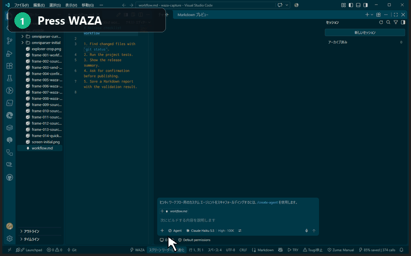

# Waza - One-Click Skill Compiler

[日本語版](README.ja.md)



Waza turns an explicitly selected AI workflow and the current Git diff into a reusable Agent Skill for VS Code. It generates `SKILL.md`, a deterministic script, and a test definition, then shows a preview and validates the script before saving.

## Features

- Start compilation from the `WAZA` status-bar key or the `Waza: Compile Workflow to Skill` command.
- Use the active editor or select Markdown, JSON, JSONL, text, and log files as workflow evidence.
- Include Git status, diff statistics, changed-file names, and diff text in the compiler input.
- Redact common API keys, access tokens, bearer credentials, and passwords before model submission.
- Confirm the selected sources, input size, and redaction count before sending anything to a VS Code language model.
- Choose from installed Bun, Node.js, Python, PowerShell, Rust, and Zig runtimes.
- Preview the generated `SKILL.md`, script, test definition, and risk warnings before saving.
- Reject generated scripts that do not implement `--help` and `--dry-run`.
- Run a syntax or build check before any skill file is saved.
- Warn about recursive deletion, Git mutations, network access, environment-variable reads, and subprocess use.
- Open the last generated skill from the `TRY` key as an unsent, reviewable chat prompt.
- Roll back a save if any managed skill file fails to commit.

## Use Waza

1. Open a workspace folder.
2. Open or create the workflow transcript, notes, JSON, or log that you want to compile.
3. Select the `WAZA` status-bar key, or run `Waza: Compile Workflow to Skill` from the Command Palette.
4. Choose `Use active editor` or select one or more workflow files.
5. Review the source count, redacted-value count, Git warnings, and input size. Continue only when the evidence is correct.
6. Select the VS Code language model when more than one model is available.
7. Review the generated Markdown preview and any risk warnings.
8. Select `Save validated skill` after the syntax gate succeeds.
9. Waza writes the skill to `.github/skills/<skill-name>/`.
10. Select the `TRY` key to open a natural-language trigger as a partial chat query. Review it before sending.

## Privacy And Safety

Waza does not silently scan Copilot Chat's private storage. The selected editor or explicitly chosen files are the only transcript inputs. Git diff data is added from the current workspace.

Waza sends selected evidence to a VS Code language model only after a confirmation dialog. Redaction is a safety aid, not a guarantee. Review the listed sources and remove sensitive content before continuing when required.

Generated skills are saved only after model output validation, script syntax validation, preview, and user confirmation. Destructive, network, environment, and subprocess operations remain visible in the warning summary.

## Settings

- `waza.preferredRuntime`: `auto`, `bun`, `node`, `python`, `powershell`, `rust`, or `zig`.
- `waza.maxInputCharacters`: Maximum selected workflow text sent to the language model.
- `waza.showRiskWarnings`: Show save-time warnings for generated scripts.

## Keyboard Shortcuts

- `Ctrl+Alt+W` or `Cmd+Alt+W`: Compile the selected workflow into a skill.
- `Ctrl+Alt+Enter` or `Cmd+Alt+Enter`: Open the last compiled skill in chat.

## Development

```bash
npm install
npm run typecheck
npm test
npm run build
npm run package
```

## Related tools

| When you need... | Extension | Role |
| --- | --- | --- |
| Long-term recall across chats | [Kioku](https://marketplace.visualstudio.com/items?itemName=ShunsukeF.kioku-search) | Saves and searches lessons from earlier tasks. |
| Structured test and build diagnostics | [Zuma MCP](https://marketplace.visualstudio.com/items?itemName=ShunsukeF.inazuma-pwsh) | Returns concise failures from supported development tools. |
| A fresh chat before context gets overloaded | [Tsugi](https://marketplace.visualstudio.com/items?itemName=ShunsukeF.tsugi) | Creates a reviewed handoff prompt for the next chat. |

## License

Apache-2.0
